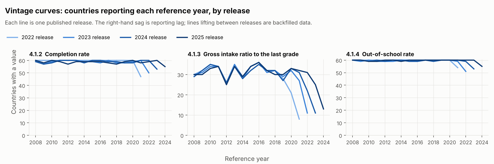
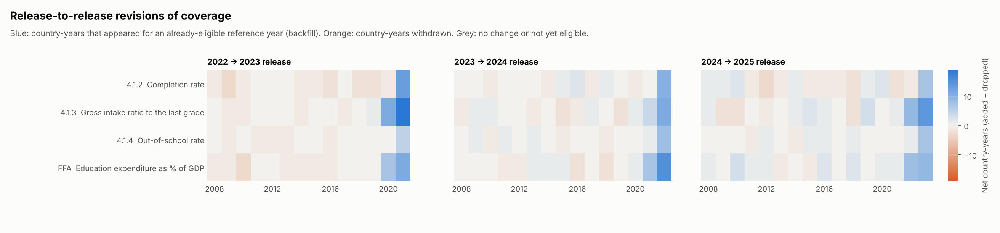
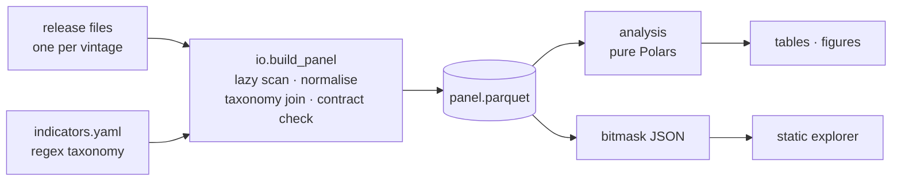

# sdg4vintage

**Release-vintage analytics for SDG 4 education statistics: what changes between one data release and the next?**

[](https://github.com/EllenSyuu/SDG/actions/workflows/ci.yml)


Statistical databases are republished as successive snapshots. Each new release adds
the latest year, **backfills** older years with late-arriving values, and **withdraws or
revises** values published before. Users who read trends or coverage off one release
see all three mixed with real change in the world.

`sdg4vintage` treats each release as a **data vintage** — the way macroeconomists treat
successive GDP estimates — and measures those effects directly: reporting lag, backfill,
withdrawal, value revision, and how much coverage depends on administrative data,
household surveys or models. It is a typed, tested Python package with a CLI, a
synthetic data generator with known ground truth, and a static interactive explorer.

> All figures below come from `sdg4v demo` (synthetic data). The repository contains no
> real data.





## What it measures

| Metric | Question it answers |
|---|---|
| Vintage curves | How many countries report each reference year, as seen by each release? |
| Expanding / rolling coverage | Which countries have *ever* / *recently* reported, optionally population-weighted? |
| Source layers | How much coverage comes from admin data alone vs. + surveys vs. + models? |
| Transition flows | Which country-years were backfilled or withdrawn between consecutive releases? |
| Value revisions | How often, and by how much, do published values change in the next release? |

Exact definitions, design choices and limitations: [docs/methodology.md](docs/methodology.md).

## Quick start

```bash
git clone https://github.com/EllenSyuu/SDG && cd SDG
python -m pip install -e ".[dev]"

sdg4v demo          # synthetic releases → panel → tables + figures in build/demo
make check          # ruff + mypy --strict + pytest
make explorer       # interactive explorer on the demo data at http://localhost:8000
```

To run on your own releases, put them in the layout described in
[docs/data.md](docs/data.md) and run `sdg4v run`. Every parameter — releases, reference
window, eligibility rule, lookback length, revision tolerance — lives in
[`config/default.yaml`](config/default.yaml).

## Engineering



* **Config, not copies.** Analysis variants (eligibility rule, window, lookback) are
  fields of one validated `pydantic` model rather than duplicated scripts.
* **A taxonomy you can review.** Indicators are defined by ordered regex rules over
  series identifiers and tagged admin / household survey / model; ambiguous matches
  fail loudly.
* **A data contract.** Ingestion normalises schema drift between releases (e.g. header
  case) and guarantees schema, unique keys, non-null keys and code format before any
  metric runs.
* **Lazy, single-pass ingestion** with Polars: only rows of mapped series are ever
  materialised; the panel is stored as zstd Parquet.
* **Tests that need no data.** 51 tests, 97 % line coverage: exact-value unit tests,
  Hypothesis property tests (e.g. flow conservation `old + added − dropped = new`), and
  an end-to-end run on a generator that plants lags, backfills, retractions and
  revisions and checks they are recovered.
* **CI** on Python 3.11–3.13 (lint, `mypy --strict`, tests, demo run), plus an on-demand
  workflow that deploys the explorer to GitHub Pages from synthetic data.

More in [docs/architecture.md](docs/architecture.md).

## Repository layout

```
config/            run settings (default, demo) and the indicator taxonomy
src/sdg4vintage/   config · taxonomy · io · analysis · plots · explorer · synthetic · cli
tests/             unit, property, contract and end-to-end tests
docs/              methodology, data layout, architecture, explorer page, demo figures
```

## Citation

See [`CITATION.cff`](CITATION.cff). Code under the [MIT licence](LICENSE).
