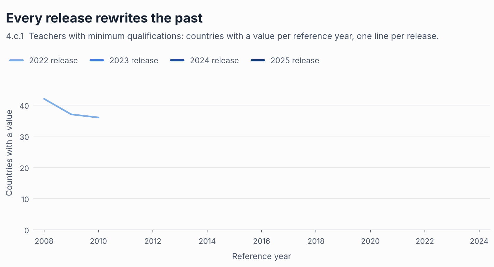
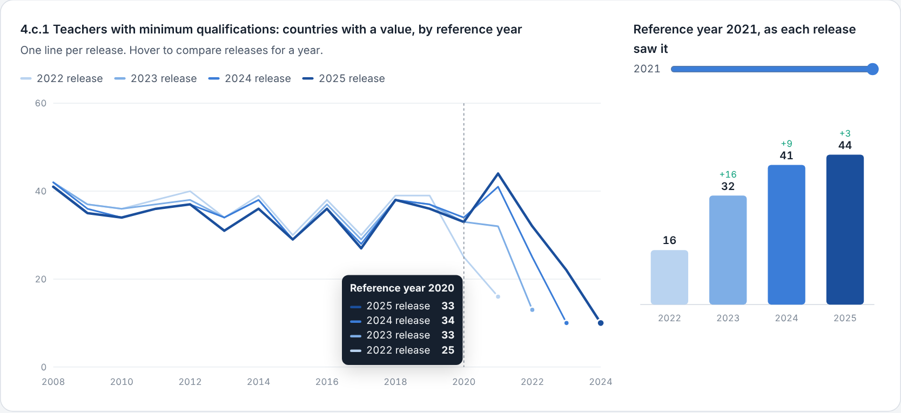
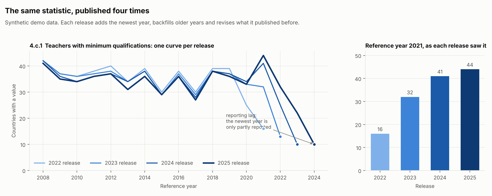
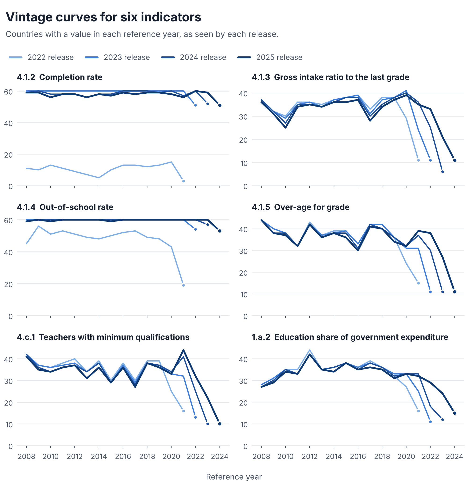
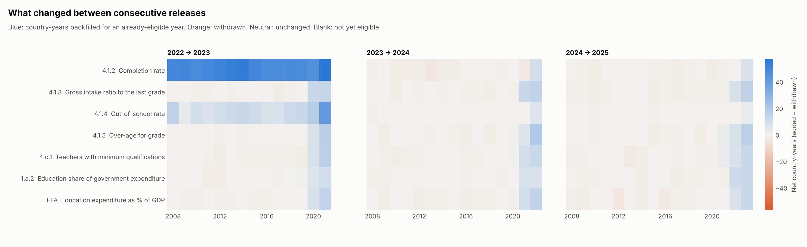
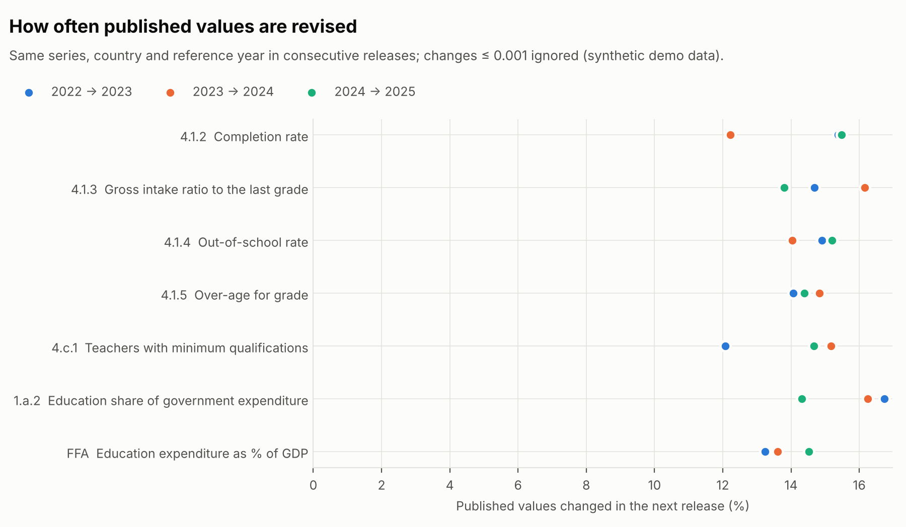
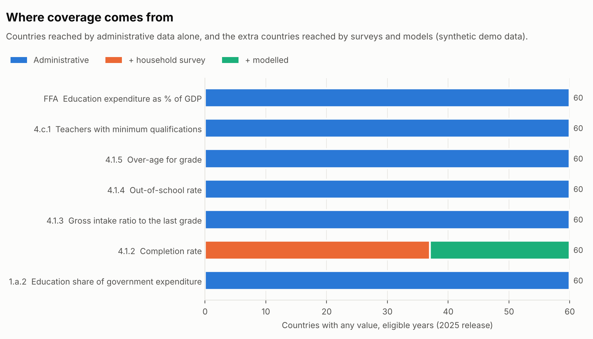
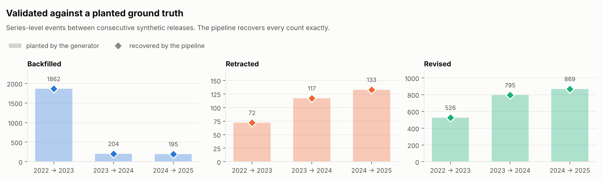
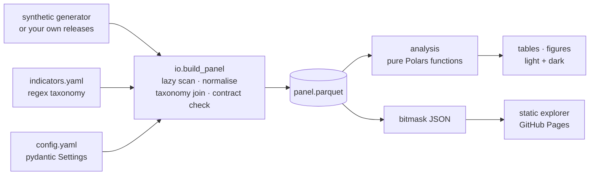

<div align="center">

# sdg4vintage

**Release-vintage analytics for SDG 4 education statistics**

*Measure what changes between one data release and the next: reporting lag, backfill, withdrawals and value revisions.*

[](https://github.com/EllenSyuu/SDG/actions/workflows/ci.yml)


[](LICENSE)

**[Live explorer](https://ellensyuu.github.io/SDG/)** · [Why](#why) · [Quick start](#quick-start) · [What it measures](#what-it-measures) · [Validation](#validated-against-a-planted-ground-truth) · [Engineering](#engineering) · [Docs](docs/)

</div>

<picture>
  <source media="(prefers-color-scheme: dark)" srcset="docs/img/hero-dark.gif">
  
</picture>

<sub>All figures in this repository are generated from **synthetic data** by `sdg4v demo`. The repository contains no real data.</sub>

## Why

Statistical databases are republished as successive snapshots. Each new release adds
the latest year, **backfills** older years with late-arriving values, and **withdraws or
revises** values it published before. Anyone who reads a trend, a coverage rate or a
progress assessment off a single release sees all of that mixed in with real change in
the world.

`sdg4vintage` treats every release as a **data vintage**, the way macroeconomists treat
successive GDP estimates, and separates the two kinds of change. It is a typed, tested
Python package with a CLI, a deterministic synthetic generator that serves as ground
truth, publication-ready figures and a static interactive explorer.

## Interactive explorer

A static, dependency-free page that lets you switch indicator, hover any reference year
to compare releases, scrub through releases on the country × year matrix, see what each
release added or withdrew, and check the pipeline's counts against the generator's
planted record. It is built from synthetic data by `scripts/build_site.py` and deployed
with GitHub Pages.

<a href="https://ellensyuu.github.io/SDG/">
<picture>
  <source media="(prefers-color-scheme: dark)" srcset="docs/img/explorer-dark.png">
  
</picture>
</a>

<picture>
  <source media="(prefers-color-scheme: dark)" srcset="docs/img/hero-dark.png">
  
</picture>

## Quick start

```bash
git clone https://github.com/EllenSyuu/SDG && cd SDG
python -m pip install -e ".[dev]"

sdg4v demo       # synthetic releases → panel → tables + figures in build/demo
make check       # ruff · mypy --strict · pytest (55 tests)
make explorer    # build the explorer from synthetic data and serve it at localhost:8000
```

To analyse your own releases, place them in the layout described in
[docs/data.md](docs/data.md) and run `sdg4v run`. Every parameter (releases, reference
window, eligibility rule, lookback length, revision tolerance) lives in
[`config/default.yaml`](config/default.yaml).

## What it measures

| Metric | Question it answers |
|---|---|
| **Vintage curves** | How many countries report each reference year, as seen by each release? |
| **Expanding / rolling coverage** | Which countries have *ever* / *recently* reported, optionally population-weighted? |
| **Source layers** | How much coverage comes from administrative data alone, and how much from surveys and models? |
| **Transition flows** | Which country-years were backfilled or withdrawn between consecutive releases? |
| **Value revisions** | How often, and by how much, do published values change in the next release? |

<picture>
  <source media="(prefers-color-scheme: dark)" srcset="docs/img/vintage_curves-dark.png">
  
</picture>

<picture>
  <source media="(prefers-color-scheme: dark)" srcset="docs/img/transition_flows-dark.png">
  
</picture>

<table>
<tr>
<td width="50%">
<picture>
  <source media="(prefers-color-scheme: dark)" srcset="docs/img/value_revisions-dark.png">
  
</picture>
</td>
<td width="50%">
<picture>
  <source media="(prefers-color-scheme: dark)" srcset="docs/img/source_layers-dark.png">
  
</picture>
</td>
</tr>
</table>

Exact definitions, design choices and limitations: [docs/methodology.md](docs/methodology.md).

## Validated against a planted ground truth

The synthetic generator plants every effect the pipeline measures (publication lag,
backfill, permanent retraction, value revision, a mid-series method change, header
drift and distractor series) and records each planted event in a ledger.
`tests/test_ground_truth.py` requires the pipeline's series-level ledger to match it
**exactly**, for several random seeds:

| Transition | Retained | Backfilled | Retracted | Revised |
|---|---:|---:|---:|---:|
| 2022 → 2023 | 3,646 | 1,862 | 72 | 526 |
| 2023 → 2024 | 5,583 | 204 | 117 | 795 |
| 2024 → 2025 | 5,847 | 195 | 133 | 869 |

<sub>Seed 42, 60 placeholder countries, 12 series. Planted and recovered counts are identical in every cell.</sub>

<picture>
  <source media="(prefers-color-scheme: dark)" srcset="docs/img/ground_truth-dark.png">
  
</picture>

## Engineering



| Principle | How it shows up |
|---|---|
| **Configuration, not copies** | Analysis variants (eligibility rule, window, lookback, tolerance) are fields of one validated `pydantic` model. |
| **A reviewable taxonomy** | Indicators are ordered regex rules over series identifiers, tagged admin / household survey / model; an ambiguous match fails loudly. |
| **An explicit data contract** | Ingestion normalises schema drift and guarantees schema, unique keys, non-null keys and code format before any metric runs. |
| **Lazy, single-pass ingestion** | Polars scans each release once and materialises only mapped series; the panel is stored as zstd Parquet. |
| **Pure analytics** | Every metric is a side-effect-free function from panel to tidy frame. |
| **Tests that need no data** | Exact-value unit tests, Hypothesis property tests (e.g. flow conservation `old + added − dropped = new`), contract tests, ground-truth tests and an end-to-end run. 98 % line coverage. |
| **Reproducible outputs** | Deterministic generator; every README image (PNG and animated GIF, light and dark) is re-rendered by `scripts/render_assets.py`, and CI rebuilds them and the explorer site on every push. |
| **Automation** | CI on Python 3.11–3.13 (lint, `mypy --strict`, tests, demo, asset rendering), Dependabot, on-demand Pages deployment. |

More in [docs/architecture.md](docs/architecture.md).

## Repository layout

```
config/            run settings (default, demo) and the indicator taxonomy
src/sdg4vintage/   config · taxonomy · io · analysis · plots · explorer · synthetic · pipeline · cli
scripts/           render_assets.py (README images) · build_site.py (explorer site)
tests/             unit, property, contract, ground-truth and end-to-end tests
docs/              methodology, data layout, architecture, explorer page, images
```

## Citation and licence

If you use this software, please cite it via [`CITATION.cff`](CITATION.cff) (GitHub's
"Cite this repository" button). Released under the [MIT licence](LICENSE).
