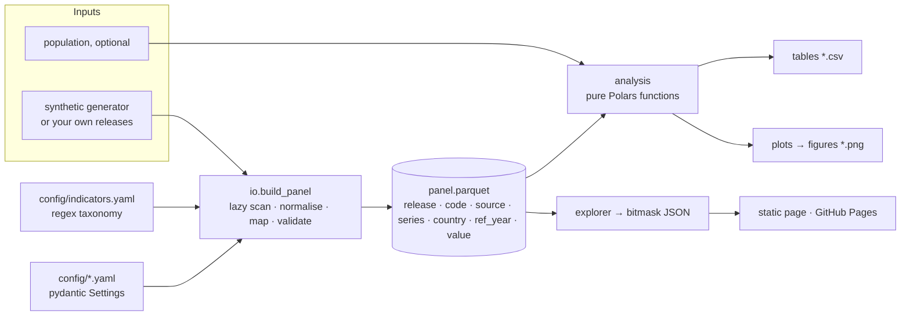

# Architecture

## Modules

| Module | Responsibility | Notes |
|---|---|---|
| `config.py` | Typed, validated run settings | Paths, releases, window, eligibility rule, lookback and tolerance are fields, not constants scattered through scripts. Relative paths resolve against the repo, so configs are portable. |
| `taxonomy.py` | Series → (indicator, source) | Ordered full-match regex rules; ambiguity raises. |
| `io.py` | Release files → panel; population | Lazy Polars scans, filtered by a join on the taxonomy's series before materialising. `validate_panel` guards schema, key uniqueness, nulls and code shape. |
| `analysis.py` | All metrics | Pure functions, panel in / tidy frame out; no I/O, no globals. |
| `synthetic.py` | Ground-truth data generator | Exact file layout; planted lags, backfills, retractions, revisions, a method change, header drift and distractor series; returns a ledger of every planted event. |
| `pipeline.py` | Orchestration | One call: panel → tables → figures → `summary.json`. |
| `plots.py` | Static figures, light and dark themes | Colour by role: sequential for ordered releases, diverging with a neutral midpoint for net change, three fixed categorical slots for sources. Title blocks are laid out in inches so they never collide with content. |
| `explorer.py` | Data for the web explorer | Country × year presence as integer bitmasks. |
| `cli.py` | `sdg4-revisions` entry point | `run`, `demo`, `explorer`. |
| `scripts/render_assets.py` | README images | Re-renders every figure and the animated hero in `docs/img` from synthetic data, in both themes. |
| `scripts/build_site.py` | Explorer site | Synthetic data → pipeline → `data.json` (with the planted ledger) + `index.html`, deployed to GitHub Pages. |

## Design decisions

* **Variants are configurations, not files.** Whether the release year itself is an
  eligible reference year, the window end and the lookback length are parameters, so
  a sensitivity check is a config change.
* **Explicit data contract** between ingestion and analysis, checked on every build and
  on every read of the Parquet panel.
* **Single pass, lazy ingestion.** Each release is scanned once; only rows of mapped
  series are materialised.
* **Correctness without data.** Unit tests with exact expected values, property tests,
  and an end-to-end test on synthetic data with known planted effects.

## Testing strategy

| Layer | What | Where |
|---|---|---|
| Unit | Exact values on a 7-row panel covering backfill, retraction, revision, null values, ineligible years, both eligibility rules | `tests/test_analysis.py` |
| Property | `expanding ≥ any single year`, `rolling ≥ point-in-time`, `old + added − dropped = new` on random panels (Hypothesis) | `tests/test_analysis.py` |
| Contract | Schema, duplicate keys, malformed headers, missing files, Parquet round trip | `tests/test_io.py` |
| Taxonomy | Known series, near misses, ambiguity | `tests/test_taxonomy.py` |
| Ground truth | Series-level backfills, retractions and revisions equal the generator's ledger exactly, for several seeds; method change visible | `tests/test_ground_truth.py` |
| End to end | Synthetic releases → all tables, figures, explorer payload | `tests/test_pipeline.py` |
